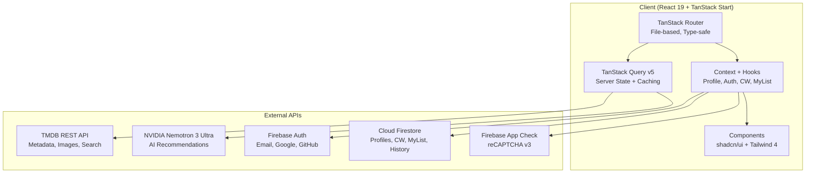

# StreamFlix

[](https://opensource.org/licenses/MIT)
[](https://www.typescriptlang.org/)
[](https://react.dev/)
[](https://tanstack.com/router)
[](https://tanstack.com/start)
[](https://vite.dev/)
[](https://tailwindcss.com/)
[](https://firebase.google.com/)
[](https://vercel.com/)

> **A modern, full-featured streaming platform** — Netflix-style UI, multi-profile support, AI recommendations, cross-device sync, and enterprise-grade security. Built with React 19, TanStack Start, TypeScript, Firebase, and TMDB.

**Live Demo:** [https://streamflix.dpdns.org](https://streamflix.dpdns.org)

---

## Why StreamFlix?

| Problem | StreamFlix Solution |
|---------|---------------------|
| Fragmented content across services | **Unified browse** — TMDB metadata + multiple embed providers in one UI |
| Lost watch progress | **Continue Watching** — Local-first + Firestore sync, survives device switches |
| No safe viewing for kids | **Kids Mode** — PIN-protected profiles, genre/rating filtering |
| Discovery is hard | **AI Recommendations** — NVIDIA Nemotron powered, context-aware suggestions |
| Security afterthought | **App Check + Turnstile** — reCAPTCHA v3, rate limiting, iframe sandboxing |
| Poor developer experience | **Type-safe everything** — TanStack Router + Query, Zod schemas, ESLint/Prettier |

---

## Features Deep Dive

### Content Discovery
- **Home Feed** — Hero banner, trending, popular, continue watching, My List, new releases, genre rows
- **Explore** — Genre pages with infinite scroll, filter by year/rating, sort options
- **Search** — Debounced TMDB multi-search (movies, TV, people) with filters & pagination
- **Detail Pages** — Cast, crew, videos, watch providers, recommendations, similar titles
- **Mood-Based Discovery** — "Feel good", "Dark & Gritty", "Mind Bending", etc.

### Profile System (Netflix-Style)
- Up to **5 profiles per account**
- Custom name, avatar (upload / TMDB actor picker / initials), color theme
- **Kids Mode** — Blocks horror, thriller, crime, romance, mystery, drama, war + ratings > PG/TV-PG
- **PIN Protection** — Optional 6-digit PIN per profile
- **Content Rating Limits** — G → NC-17 per profile
- **Session Persistence** — `sessionStorage` + custom `profileChanged` events

### Video Playback
- **Multi-Provider Fallback** — vidking, vsembed, 2embed, multiembed, videasy
- **Secure iframe** — `sandbox` + `allow` policies, CSP frame-src locked to providers
- **TV Support** — Season/episode picker, auto-play next, skip intro
- **PiP & Fullscreen** — Native browser APIs
- **Subtitles** — WebVTT support where provider offers

### Continue Watching (Cross-Device)
```
localStorage (instant) → Firestore (persistent) → Multi-tab sync → Offline queue
```
- Progress saved **every 5 seconds** during playback
- Episode-level tracking for TV shows
- Auto-cleanup (max 50 entries per profile)
- Instant resume on any device

### My List (Watchlist)
- Optimistic UI (instant add/remove)
- localStorage + Firestore dual-write
- Cross-tab broadcast via `BroadcastChannel`
- Dedicated page with grid/filter/sort

### AI Recommendations
```typescript
// lib/api/ai.ts
export async function askStreamflixAI(prompt: string): Promise<string>
// Context: watch history, favorites, preferences, current profile
// Model: NVIDIA Nemotron 3 Ultra via NVIDIA NIM API
```

### Security & Privacy
| Layer | Implementation |
|-------|----------------|
| **API Abuse** | Firebase App Check (reCAPTCHA v3) |
| **Bot Protection** | Cloudflare Turnstile on auth forms |
| **XSS/Injection** | Strict CSP, Trusted Types, iframe sandbox |
| **Auth** | Firebase Auth (Email/Pass, Google, GitHub) + email verification |
| **Password Policy** | 8+ chars, upper/lower/number/special, real-time strength meter |
| **Rate Limiting** | 5 req/min on auth endpoints (client + server) |
| **Data** | Minimal PII, user-controlled deletion, consent-first analytics |

### Accessibility
- Semantic HTML, ARIA labels, focus management
- Keyboard navigation throughout
- Reduced motion support
- High contrast mode compatible
- Screen reader tested (NVDA, VoiceOver)

---

## Architecture



### Key Design Decisions

| Decision | Rationale |
|----------|-----------|
| **TanStack Start (SSR)** | SEO, faster FCP, streaming HTML, route loaders |
| **File-based Routing** | Type-safe URLs, auto-generated route tree, layout routes |
| **TanStack Query** | Deduplication, caching, retries, optimistic updates |
| **localStorage-first** | Instant UX, Firestore sync in background |
| **Zod everywhere** | Runtime validation = type safety at boundaries |
| **shadcn/ui primitives** | Accessible, customizable, zero-runtime CSS-in-JS |
| **Vite + Nitro** | Fast dev, optimized Vercel output, serverless API routes |

---

## Project Structure

```
streamflix/
├── public/                     # Static assets (favicons, manifest, sw.js)
├── src/
│   ├── assets/                 # Images, fonts, logos
│   ├── components/
│   │   ├── streamflix/         # Feature components (domain-specific)
│   │   │   ├── AvatarCropModal.tsx
│   │   │   ├── ContinueWatching.tsx
│   │   │   ├── DownloadAppButton.tsx
│   │   │   ├── Footer.tsx
│   │   │   ├── HeroBanner.tsx
│   │   │   ├── LazyImage.tsx
│   │   │   ├── LegalVersionBanner.tsx
│   │   │   ├── Logo.tsx
│   │   │   ├── MovieCard.tsx           # Portrait + Landscape
│   │   │   ├── MovieCardSkeleton.tsx
│   │   │   ├── Navbar.tsx
│   │   │   ├── Row.tsx / RowSkeleton.tsx
│   │   │   ├── ScreenSaver.tsx         # Ken Burns + metadata
│   │   │   ├── SeasonEpisodePicker.tsx
│   │   │   ├── ShareButton.tsx
│   │   │   ├── TmdbAvatarPicker.tsx    # Actor search modal
│   │   │   ├── VideoPlayer.tsx         # iframe + postMessage
│   │   │   └── ...
│   │   └── ui/                 # shadcn/ui primitives
│   │       ├── button.tsx
│   │       ├── carousel.tsx
│   │       ├── dialog.tsx
│   │       ├── skeleton.tsx
│   │       ├── toast.tsx
│   │       └── ...
│   ├── hooks/                  # Custom React hooks
│   │   ├── use-mobile.ts
│   │   ├── use-debounce.ts
│   │   ├── use-local-storage.ts
│   │   └── ...
│   ├── lib/                    # Core libraries (singletons, clients, utils)
│   │   ├── api/
│   │   │   ├── ai.ts           # NVIDIA Nemotron client
│   │   │   └── tmdb.ts         # TMDB wrapper (typed, cached)
│   │   ├── auth/               # Auth helpers, password policy
│   │   ├── continue-watching.ts     # CW logic + Firestore sync
│   │   ├── continue-watching-server.ts
│   │   ├── firebase.ts         # Firebase init + App Check
│   │   ├── my-list.ts          # Watchlist CRUD + sync
│   │   ├── profiles.ts         # Profile CRUD + types
│   │   ├── selected-profile.ts # sessionStorage + events
│   │   ├── kids-mode.ts        # Filtering logic
│   │   ├── consent.ts          # Cookie consent (granular)
│   │   ├── rate-limiter.ts     # Client-side token bucket
│   │   ├── error-handler.ts    # Global error boundary + Sentry-ready
│   │   ├── seo.ts              # Dynamic meta tags
│   │   ├── session-tracking.ts # Analytics helpers
│   │   ├── title-logo.ts       # TMDB logo URL builder
│   │   ├── password.ts         # Policy + strength meter
│   │   ├── turnstile.ts        # Cloudflare Turnstile
│   │   ├── runtime.ts          # formatRuntime, formatDate, etc.
│   │   ├── user-versions.ts    # TOS/Privacy version tracking
│   │   └── utils.ts            # cn(), formatters, validators
│   ├── routes/                 # TanStack Router file-based routes
│   │   ├── _authenticated/     # Protected layout
│   │   │   ├── browse.tsx
│   │   │   ├── explore/
│   │   │   │   └── $genreId.tsx
│   │   │   ├── movie.$id.tsx
│   │   │   ├── watch.$id.tsx
│   │   │   ├── profiles.tsx
│   │   │   ├── settings.tsx
│   │   │   ├── force-password.tsx
│   │   │   └── ...
│   │   ├── auth.tsx            # Sign in / up (Turnstile)
│   │   ├── index.tsx           # Landing (SSR)
│   │   ├── tos.tsx
│   │   └── privacy-policy.tsx
│   ├── styles/
│   │   └── globals.css         # Tailwind 4 + CSS vars
│   ├── types/
│   │   └── index.ts            # Shared TypeScript types
│   ├── App.tsx
│   ├── main.tsx                # Entry, providers, queryClient
│   └── routeTree.gen.ts        # Auto-generated (do not edit)
├── .env.example
├── .eslintrc.cjs
├── .prettierrc
├── package.json
├── tsconfig.json
├── vite.config.ts
├── tailwind.config.ts
├── vercel.json                 # CSP, headers, rewrites, crons
├── firebase.json               # Hosting, Firestore rules, indexes
├── firestore.rules
├── firestore.indexes.json
└── STREAMFLIX_DOCUMENTATION.html  # Full technical docs
```

---

## Getting Started

### Prerequisites
- **Node.js 20+** (LTS recommended)
- **npm 10+** or **bun 1.1+**
- **Firebase Project** — Auth, Firestore, App Check enabled
- **TMDB Account** — API Key (v4 Bearer + v3 fallback)
- **NVIDIA API Key** (optional) — For AI recommendations
- **Cloudflare Turnstile** (optional) — Bot protection on auth

### Quick Start

```bash
# 1. Clone & install
git clone https://github.com/Wayne-Inc/StreamFlix.git
cd StreamFlix
npm install

# 2. Configure environment
cp .env.example .env.local
# Edit .env.local with your keys (see table below)

# 3. Start development server
npm run dev
# → http://localhost:5173
```

### Environment Variables

| Variable | Required | Scope | Description |
|----------|----------|-------|-------------|
| `VITE_FIREBASE_API_KEY` | ✅ | Client | Firebase Web API Key |
| `VITE_FIREBASE_AUTH_DOMAIN` | ✅ | Client | `project.firebaseapp.com` |
| `VITE_FIREBASE_PROJECT_ID` | ✅ | Both | Firebase Project ID |
| `VITE_FIREBASE_STORAGE_BUCKET` | ✅ | Client | `project.appspot.com` |
| `VITE_FIREBASE_MESSAGING_SENDER_ID` | ✅ | Client | FCM Sender ID |
| `VITE_FIREBASE_APP_ID` | ✅ | Client | Firebase App ID (`1:xxx:web:xxx`) |
| `VITE_FIREBASE_VAPID_KEY` | ⚠️ | Client | FCM Web Push VAPID key |
| `VITE_TMDB_API_KEY` | ✅ | Both | TMDB v4 Bearer Token |
| `VITE_TMDB_V3_API_KEY` | ✅ | Both | TMDB v3 API Key (fallback) |
| `VITE_NVIDIA_API_KEY` | ❌ | Server | NVIDIA NIM API Key |
| `VITE_TURNSTILE_SITE_KEY` | ⚠️ | Client | Turnstile Site Key |
| `TURNSTILE_SECRET_KEY` | ⚠️ | Server | Turnstile Secret (Vercel env) |
| `VITE_APP_CHECK_SITE_KEY` | ❌ | Client | reCAPTCHA v3 Site Key |
| `VITE_SITE_URL` | ✅ | Both | `https://streamflix.dpdns.org` |
| `CRON_SECRET` | ✅ | Server | Bearer token for `/api/release-notifications-cron` |
| `VITE_FIREBASE_EMULATOR` | ❌ | Client | Set `1` for local emulator |
| `VITE_FIREBASE_EMULATOR_HOST` | ❌ | Client | Emulator host (default: `127.0.0.1`) |

> **Security:** Server-only secrets (`TURNSTILE_SECRET_KEY`, Firebase Admin SDK) go in **Vercel Project Settings → Environment Variables**, never in `.env`.

### Firebase Setup

1. **Authentication** → Enable Email/Password, Google, GitHub providers
2. **Firestore** → Create database, deploy `firestore.rules` + `firestore.indexes.json`
3. **App Check** → Register reCAPTCHA v3 site, add Site Key to `VITE_APP_CHECK_SITE_KEY`
4. **Hosting** (optional) → `firebase deploy --only hosting`

```bash
# Deploy Firestore rules & indexes
firebase deploy --only firestore:rules,firestore:indexes
```

---

## Available Scripts

| Command | Description |
|---------|-------------|
| `npm run dev` | Start Vite dev server (port 5173, HMR) |
| `npm run build` | Production build → `.vercel/output` |
| `npm run build:dev` | Development-mode build (no minify) |
| `npm run preview` | Preview production build locally |
| `npm run lint` | Run ESLint (with auto-fix) |
| `npm run typecheck` | TypeScript compile check (`tsc --noEmit`) |
| `npm run format` | Format with Prettier |
| `npm run sitemap` | Generate `sitemap.xml` for SEO |

### Git Hooks (Husky + lint-staged)
```bash
# Pre-commit runs automatically:
#   - eslint --fix on staged files
#   - prettier --write on staged files
```

---

## Deployment

### Vercel (Recommended)

```bash
# One-time setup
vercel link
# Add all env vars in Vercel Dashboard → Settings → Environment Variables

# Deploy preview
vercel

# Deploy production
vercel --prod
```

**vercel.json** handles:
- SPA rewrites (`/* → /index.html`)
- **CSP Headers** (strict, with Google/Firebase/recaptcha allowances)
- Security headers (HSTS, X-Frame-Options, COOP, Permissions-Policy)
- Cron job for release notifications (`0 8 * * *`)

### Docker

```dockerfile
# Multi-stage build
FROM node:20-alpine AS builder
WORKDIR /app
COPY package*.json ./
RUN npm ci
COPY . .
RUN npm run build

FROM nginx:alpine
COPY --from=builder /app/.vercel/output/static /usr/share/nginx/html
COPY nginx.conf /etc/nginx/conf.d/default.conf
EXPOSE 80
CMD ["nginx", "-g", "daemon off;"]
```

### Firebase Hosting (Alternative)

```bash
npm run build
firebase deploy --only hosting
```

---

## Testing & Quality

```bash
# Type safety
npm run typecheck          # tsc --noEmit

# Linting
npm run lint               # ESLint + Prettier

# Format check
npm run format -- --check  # CI-friendly

# Full CI pipeline (run before PR)
npm run typecheck && npm run lint && npm run build
```

### Code Standards
- **TypeScript strict mode** — No `any`, explicit returns
- **ESLint** — `typescript-eslint`, `react-hooks`, `prettier`
- **Prettier** — Single quotes, trailing commas, 100-char lines
- **Conventional Commits** — `feat:`, `fix:`, `docs:`, `refactor:`

---

## Troubleshooting

| Issue | Solution |
|-------|----------|
| **App Check errors** | Verify `VITE_APP_CHECK_SITE_KEY`, check reCAPTCHA v3 domain allowlist |
| **CSP violations** | Check browser console → update `vercel.json` CSP → redeploy |
| **Auth popup blocked** | Ensure `Cross-Origin-Opener-Policy: same-origin-allow-popups` |
| **Firestore permission denied** | Deploy `firestore.rules`, verify user profile exists |
| **TMDB 401/429** | Verify API keys, check rate limits (40 req/10s) |
| **Video won't play** | Check iframe CSP `frame-src`, provider availability |
| **Hydration mismatch** | Ensure server/client render same data (use `useSyncExternalStore`) |

---

## Documentation

| Document | Purpose |
|----------|---------|
| **[STREAMFLIX_DOCUMENTATION.html](STREAMFLIX_DOCUMENTATION.html)** | Complete technical reference (architecture, components, APIs, security) |
| **[APP_CHECK_SETUP.html](APP_CHECK_SETUP.html)** | Firebase App Check / reCAPTCHA v3 setup guide |
| **`.env.example`** | Environment variable template |
| **`firestore.rules`** | Security rules reference |
| **`vercel.json`** | Headers, CSP, rewrites, crons |

---

## Contributing

```bash
# 1. Fork & branch
git checkout -b feat/amazing-feature

# 2. Make changes (follow code standards)
# 3. Run quality checks
npm run typecheck && npm run lint && npm run build

# 4. Commit (conventional)
git commit -m "feat: add amazing feature"

# 5. Push & PR
git push origin feat/amazing-feature
```

**PR Requirements:**
- TypeScript compiles (`npm run typecheck`)
- ESLint passes (`npm run lint`)
- Build succeeds (`npm run build`)
- Descriptive title + description
- Screenshots for UI changes

---

## License

**MIT License** — See [LICENSE](LICENSE) for details.

## Acknowledgments

| Project | Role |
|---------|------|
| **[TMDB](https://www.themoviedb.org/)** | Movie/TV metadata & images |
| **[Firebase](https://firebase.google.com/)** | Auth, Firestore, App Check, Hosting |
| **[TanStack](https://tanstack.com/)** | Router, Query, Start — best-in-class DX |
| **[NVIDIA Nemotron](https://www.nvidia.com/en-us/ai-data-science/nemotron/)** | AI recommendation engine |
| **[shadcn/ui](https://ui.shadcn.com/)** | Accessible component primitives |
| **[Tailwind CSS](https://tailwindcss.com/)** | Utility-first styling |
| **[Lucide](https://lucide.dev/)** | Beautiful consistent icons |
| **[Vercel](https://vercel.com/)** | Zero-config deployment |

---

## Support

- **Issues:** [GitHub Issues](https://github.com/Wayne-Inc/StreamFlix/issues)
- **Discussions:** [GitHub Discussions](https://github.com/Wayne-Inc/StreamFlix/discussions)
- **Security:** Email security@streamflix.dpdns.org (GPG key in repo)
